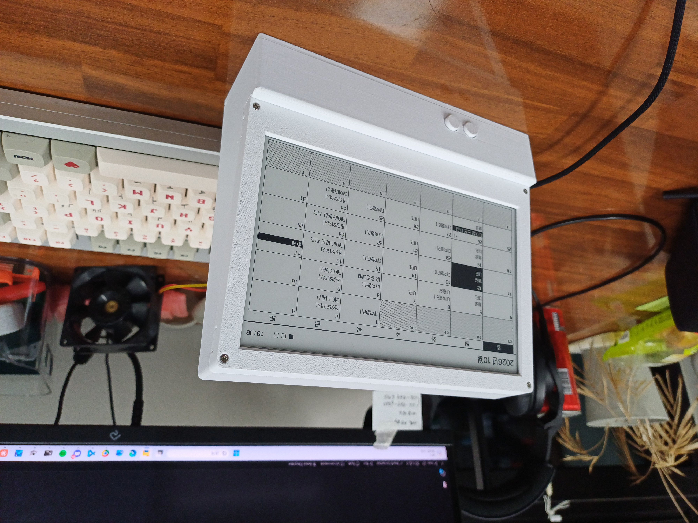
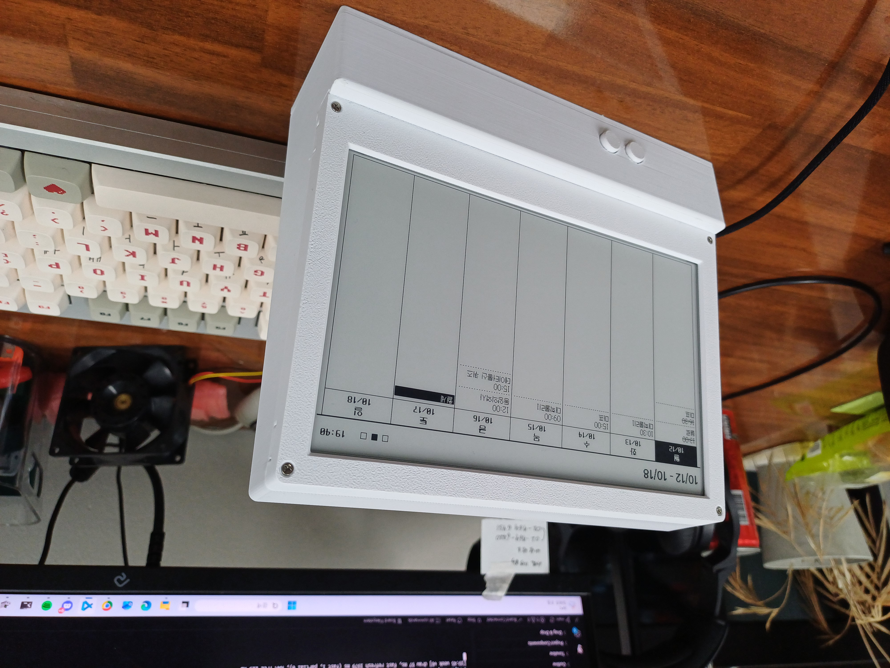
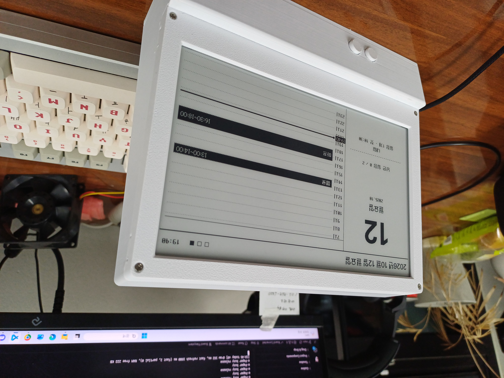

# e-Paper Google Calendar

**English** | [한국어](README.ko.md)

A desk calendar built with a Raspberry Pi Pico 2 W and a 7.5-inch e-Paper display.
It fetches your Google Calendar events every 30 minutes and shows them in **monthly / weekly / today (timeline)** views.
Because it's e-Paper, the image stays on screen even without power, it's easy on the eyes, and there's no backlight.

| Monthly | Weekly | Today |
|:---:|:---:|:---:|
|  |  |  |

> The on-screen UI is in Korean. Text lives in `app/screens/`, and the fonts include Latin characters,
> so you can translate the labels if you like.

## Features

- Automatic Google Calendar sync (every 30 minutes, or on demand with a button)
- Three views: monthly calendar, weekly schedule, today's timeline (07:00–24:00 with a "now" line)
- Korean fonts (Pretendard, Galmuri11, NeoDunggeunmo) converted to a custom bitmap format for the Pico
- Flicker-free partial refresh every 10 minutes; full refresh when events change or at midnight to clear ghosting
- Multiple Wi-Fi networks (home / school / office — connects to whichever is in range)
- Runs with sample events before any setup → you can check the display as soon as the hardware is ready
- PC preview tool that renders screens to PNG without any hardware

## How it works

```
 ┌────────────┐   HTTPS GET (every 30 min) ┌───────────────────┐      ┌─────────────────┐
 │ Pico 2 W   │ ─────────────────────────▶ │ Google Apps Script│ ───▶ │ Google Calendar │
 │ + e-Paper  │ ◀───────────────────────── │ (your account,    │      └─────────────────┘
 └────────────┘       events as JSON       │  web app)         │
                                           └───────────────────┘
```

So the Pico never has to sign in to Google, a small script running in your own Google account (Apps Script)
turns your events into JSON and serves them at a single URL. It only returns events when the secret `token`
at the end of the URL matches.

---

## 1. What you need

### Hardware

| Part | Notes |
|---|---|
| Raspberry Pi Pico 2 W | The **W** model (with Wi-Fi). A version with pre-soldered headers (Pico 2 WH) is easiest |
| Waveshare Pico-ePaper-7.5 | 7.5" black & white, 800×480, driver board the Pico plugs straight into, with KEY0/KEY1 buttons |
| USB cable | Must support data (charge-only cables won't be detected by the PC) |
| Case (optional) | 3D print the STL files in `3d_models/` |

The Pico plugs directly into the driver board, so no wiring is needed.
These are the pins the project uses (already connected on the board):

| Function | Pico pin |
|---|---|
| e-Paper DC / CS / RST / BUSY | GP8 / GP9 / GP12 / GP13 |
| e-Paper SPI (CLK / DIN) | GP10 / GP11 |
| KEY0 / KEY1 buttons | GP2 / GP3 |

> If your board revision uses different button pins, run `01_bringup/key_finder.py` to find them,
> then change `KEY0_PIN` and `KEY1_PIN` in `app/config.py`.

### Software

- [VS Code](https://code.visualstudio.com/) + the [MicroPico](https://marketplace.visualstudio.com/items?itemName=paulober.pico-w-go) extension (upload and run files on the Pico)
  - Thonny works too.
- [Python 3](https://www.python.org/) + `pip install pillow` (only needed for the PC preview and font conversion)
- A Google account (Google Calendar)

---

## 2. Install MicroPython on the Pico

1. Download the latest `.uf2` for **Pico 2 W** from the [MicroPython download page](https://micropython.org/download/RPI_PICO2_W/).
2. Hold the Pico's **BOOTSEL** button while plugging it into your PC over USB.
3. When a USB drive named `RP2350` appears, drag the `.uf2` file onto it.
4. The Pico restarts automatically — installation is done.

---

## 3. Get the code

```bash
git clone https://github.com/jiu-0317/e_ink_display.git
cd e_ink_display
```

### Folder layout

```
app/                  ← The program that runs on the Pico (only this folder is uploaded)
  main.py             ← Main loop, runs automatically on power-up
  config.py           ← Behavior settings (refresh intervals, button pins, timeline range, ...)
  credentials.example.py  ← Wi-Fi / calendar URL template (copy to credentials.py)
  screens/            ← Monthly, weekly, and today views
  gfx/ hw/ net/       ← Drawing, hardware (e-Paper, buttons, clock), networking
  fonts/              ← Korean bitmap fonts for the Pico (.epf)
  data/mock_events.json  ← Sample events shown before setup
tools/
  apps_script/        ← Apps Script (Code.gs) that exports Google Calendar as JSON, plus setup guide
  preview.py          ← Render screens to PNG on your PC
  fontgen/            ← Font → .epf converter
3d_models/            ← Case STL files
01_bringup/           ← Test scripts for the first hardware check
```

---

## 4. Check the display with sample events first

Before any setup, make sure the hardware works.

1. In VS Code, **open the `app` folder** (`File → Open Folder → app`).
   MicroPico uploads the open folder, so open `app`, not the repository root.
2. Connect the Pico over USB; the status bar should show `Pico Connected`.
3. Command Palette (`Ctrl+Shift+P`) → **MicroPico: Upload project to Pico**
4. When the upload finishes, replug the Pico or run **MicroPico: Reset** → `main.py` starts automatically.

Since there's no `credentials.py` yet, the screen shows **"예시 데이터"** ("sample data") along with sample events. If you see them, it works.

> If nothing shows up, use the test scripts in `01_bringup/` to check the e-Paper connection first.

---

## 5. Connect Google Calendar

The full step-by-step guide is in **[tools/apps_script/README.md](tools/apps_script/README.md)** (Korean). In short:

1. Go to [script.google.com](https://script.google.com) → **New project** → paste in the contents of `tools/apps_script/Code.gs`
2. Set `TOKEN` at the top to a **long random string only you know**. For example, in PowerShell:
   ```powershell
   -join ((48..57)+(65..90)+(97..122) | Get-Random -Count 40 | % {[char]$_})
   ```
   or on macOS / Linux: `openssl rand -hex 20`
3. ⚙ Project Settings → set the time zone to your own (the code assumes `Asia/Seoul` — see [Settings](#8-settings-appconfigpy))
4. Run the `test` function → grant permissions → check that events appear in the execution log
   - If you see "Google hasn't verified this app": **Advanced** → **Go to (unsafe)** → **Allow**. It's your own script reading your own calendar.
5. **Deploy → New deployment → Web app**, execute as **Me**, access **Anyone** → copy the web app URL
6. Open `WEB_APP_URL?token=YOUR_TOKEN` in a browser and check that you get `{"events": [...]}`

> ⚠️ Put your real `TOKEN` only in the Apps Script editor — never in the `Code.gs` in this repository.
> Anyone who knows the URL with the token can read your calendar.

---

## 6. Wi-Fi and calendar URL (`credentials.py`)

Copy the template and fill in your real values:

```powershell
copy app\credentials.example.py app\credentials.py     # Windows
```
```bash
cp app/credentials.example.py app/credentials.py       # macOS / Linux
```

```python
WIFI_NETWORKS = [
    ("home_wifi", "password"),      # tried in order, top to bottom
    ("school_wifi", "password"),
]

CALENDAR_URL = "https://script.google.com/macros/s/AKfy.../exec?token=YOUR_TOKEN"
```

- The Pico 2 W supports **2.4 GHz Wi-Fi only**. It can't connect to 5 GHz-only networks.
- `credentials.py` is in `.gitignore`, so it won't be pushed to GitHub. **Never commit it.**

Upload to the Pico again → reset. It connects to Wi-Fi, sets the clock (NTP), and fetches your events.
The Pico's LED is on while syncing.

---

## 7. Usage

| Button | Short press | Long press (1 s) |
|---|---|---|
| **KEY0** | Switch view (monthly → weekly → today) | Back to today |
| **KEY1** | Next month / next week / next day | Sync now + full refresh |

The `■□□` in the top right shows the current view (monthly / weekly / today), and the time next to it is when the screen was last drawn.

| View | Refresh |
|---|---|
| Today | Every 10 minutes ("now" line moves, flicker-free partial refresh) |
| Monthly / weekly | Every 30 minutes |
| All | Full refresh when events change or at midnight |

---

## 8. Settings (`app/config.py`)

Commonly changed values. Upload to the Pico again after changing them.

| Setting | Default | Description |
|---|---|---|
| `SYNC_MIN` | `30` | How often to fetch Google Calendar (minutes) |
| `TODAY_STYLE` | `"timeline"` | Today view style. `"list"` for a list layout |
| `TL_START_H` / `TL_END_H` | `7` / `24` | Hour range shown on the timeline |
| `TZ_OFFSET` | `9 * 3600` | Time zone offset from UTC (Korea = UTC+9) |
| `TODAY_TICK_PARTIAL` | `True` | Set to `False` if partial refresh looks wrong |
| `KEY0_PIN` / `KEY1_PIN` | `2` / `3` | Button GPIOs |

**Outside Korea:** change `TZ_OFFSET` here, and change `TZ` at the top of `Code.gs`
(e.g. `'America/New_York'`) together with the Apps Script project time zone.

Which calendars to fetch (e.g. adding a holiday calendar) and the date range are set at the top of `Code.gs` in Apps Script.
After editing `Code.gs`, you must **Deploy → Manage deployments → ✏ Edit → New version → Deploy** for it to take effect
("New deployment" changes the URL — avoid it).

---

## 9. 3D-printed case

STL files are in `3d_models/`.

| File | Part |
|---|---|
| `frame.stl` | Front bezel around the display |
| `display_holder.stl` | Holds the e-Paper panel / driver board |
| `base.stl` | Stand (houses the Pico and driver board) |
| `bottom_plate.stl` | Bottom cover of the stand |
| `botton.stl` | Button caps on the front of the stand (press KEY0 / KEY1) |

The case in the photos was printed in white filament, with the bezel held on by small screws.

---

## 10. Preview on your PC (no hardware)

You can render the screens to PNG on a PC without a Pico. Pico-only modules like `machine` and `framebuf`
are swapped for fakes, and the data sent to the e-Paper is decoded as-is into images.

```bash
pip install pillow
python tools/preview.py app/main.py --keys 0,0,0
```

- `--keys`: buttons to press in order. `0` = KEY0 short, `1` = KEY1 short, `1L` = KEY1 long
- Output: `preview_out/main/01_full.png, 02_fast.png ...` plus a combined `all.png`
- `--scale 2` saves enlarged images.

Handy for iterating on screen designs without uploading to the Pico every time.

---

## 11. Changing fonts (optional)

Converts the fonts in `tools/fontgen/src/` into `.epf` bitmap fonts for the Pico.

```bash
pip install pillow
python tools/fontgen/build_fonts.py
```

Output goes to `app/fonts/`. Font sizes and included characters can be changed in `build_fonts.py`.

---

## Troubleshooting

| Symptom | What to check |
|---|---|
| Screen keeps showing "예시 데이터" (sample data) | `credentials.py` was uploaded to the Pico, and `CALENDAR_URL` no longer contains the `여기에` placeholder |
| Screen shows "동기화 실패" (sync failed) | Wi-Fi is 2.4 GHz and the name/password are correct. `WEB_APP_URL?token=...` opens in a browser |
| Browser shows `{"error":"forbidden"}` | The token in the URL doesn't match `TOKEN` in `Code.gs` |
| All-day events are off by one day | The Apps Script project time zone matches `TZ` in `Code.gs` |
| Edited `Code.gs` but nothing changed | You redeployed as a **new version** under Manage deployments |
| Ghosting on screen | Long-press KEY1 for a full refresh. If it happens often, lower `PARTIALS_BEFORE_FULL` in `config.py` |
| Restarts on its own after freezing | On an error it restarts after 30 seconds. The cause is logged to `error.log` on the Pico |
| Pico not detected by the PC | Use a USB cable that supports data |

---

## License / credits

- The e-Paper driver (`epd7in5.py`) is modified from [Waveshare](https://www.waveshare.com/wiki/Pico-ePaper-7.5) example code (see the file header for the original license).
- Fonts: Pretendard (Kil Hyung-jin), Galmuri11 (Lee Minseo), NeoDunggeunmo (Dalgona) — all under the SIL Open Font License 1.1.
  See [app/fonts/FONTS_LICENSE.txt](app/fonts/FONTS_LICENSE.txt) for details.
